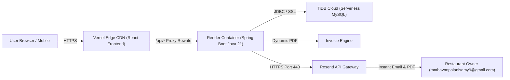

# MAD EATS — Online Food Ordering & Kitchen Dispatch Platform

A full-stack, cloud-native online food ordering and kitchen dispatch system built with React, Java 21 Spring Boot, TiDB Serverless Cloud MySQL, and Docker. Operating 100% live on the internet 24/7 with zero hosting costs.

---

## 🌐 Live Production Links

* **Live Storefront:** https://mad-eats-eight.vercel.app
* **Backend API:** https://mad-eats-backend.onrender.com
* **API Health Check:** https://mad-eats-backend.onrender.com/api/health
* **GitHub Repository:** https://github.com/Mathavan-27/mad_eats

---

## 📋 Project Overview

**MAD EATS** is a production-ready online food ordering platform designed for independent restaurants, cafes, and cloud kitchens to run their direct digital ordering business without paying 30% aggregator commissions.

### Core Problem & Solution
* **Zero Aggregator Commissions:** Allows food businesses to own their customer relationships and retain 100% of order value.
* **Frictionless Customer Flow:** Customers browse 16 signature dishes across 8 categories, customize order quantities in a real-time cart, and place orders via Cash on Delivery (COD).
* **Automated PDF Invoices:** Dynamically compiles printable invoice receipts with customer delivery coordinates, itemized totals, GST (5%), and restaurant branding.
* **Instant Cloud-Bypass Kitchen Alerts:** Uses an HTTPS-based notification pipeline (Resend API over port 443) to deliver order alerts with attached PDF invoices straight to the restaurant owner's inbox within seconds of checkout.
* **Zero-Cost 24/7 Cloud Architecture:** Deployed across Vercel (Edge CDN for React), Render (Docker runtime for Spring Boot), and TiDB Cloud (Serverless MySQL) for continuous 24/7 uptime without needing a local laptop to run.

---

## 🛠️ Technology Stack

* **Frontend:** React, Vite, Tailwind CSS, Lucide Icons, Axios / Fetch
* **Backend:** Java 21 LTS, Spring Boot 3, Spring Data JPA, Hibernate, Maven
* **Database:** TiDB Cloud Serverless MySQL (AWS Tokyo), HikariCP
* **Cloud & DevOps:** Docker, Render, Vercel, Multi-Stage Container Builds
* **Notifications & Documents:** Resend API (HTTPS Port 443), OpenPDF Document Engine
* **Payment Support:** Cash on Delivery (COD)

---

## 🏗️ System Architecture

---

## 👤 Developer Contact

* **Developer:** Mathavan P
* **Email:** mathavanpalanisamy9@gmail.com
* **Phone / WhatsApp:** +91 9363114514
* **GitHub:** https://github.com/Mathavan-27
